# Apex-OmniSwarm

**Autonomous Heterogeneous Battle-Management OS & Microsecond Sensor-to-Shooter Engine**  
*Deterministic 8-Step Pipeline Design Goal | Zero External Dependencies — no DO-178C / MIL-STD-882E certification artifacts or formal-proof evidence*

---

## Architecture Overview

Apex-OmniSwarm is a sovereign, air-gapped battle-management runtime designed to orchestrate heterogeneous swarms (scout UAVs, Collaborative Combat Aircraft, precision loitering munitions, and unmanned ground vehicles) under electronic warfare (EW) jamming and GPS denial.

```mermaid
flowchart TB
    classDef stepNode fill:#1E293B,stroke:#475569,stroke-width:1.5px,color:#F8FAFC

    subgraph PIPELINE["Apex-OmniSwarm 8-Step Autonomous Battle-Management Pipeline"]
        S1["Step 1: Multi-Modal Intent & Constitutional ROE Ingestion"]:::stepNode
        S2["Step 2: Multi-Domain Sensing & Spatial 3D Intelligence"]:::stepNode
        S3["Step 3: Swarm Grounding & Byzantine Epistemic Consensus"]:::stepNode
        S4["Step 4: Spectral Quarantine & Topology Sparsification"]:::stepNode
        S5["Step 5: Coalition Structure Generation & Task Knapsack"]:::stepNode
        S6["Step 6: Parallel Bottleneck Discovery & Microsecond Kill-Chain"]:::stepNode
        S7["Step 7: Deterministic Reflex, 4D CBF & Motor Actuation"]:::stepNode
        S8["Step 8: Post-Quantum Provenance & Metamorphic Audit"]:::stepNode
    end

    S1 --> S2 --> S3 --> S4 --> S5 --> S6 --> S7 --> S8
    S8 -.->|Closed-Loop Battle Damage Assessment / Re-Attack| S3
```



---

## The 8 Operational Steps

1. **Step 1: Multi-Modal Intent & ROE Ingestion**  
   Ingests ATAK Cursor-on-Target (CoT) and BCI neural telemetry (voice-token ingestion is roadmap). Evaluates geometric No-Fire Zone exclusions and Law of Armed Conflict (LOAC) proportionality.
2. **Step 2: Multi-Domain Sensing & Spatial 3D Intelligence**  
   Correlates radar, EO/IR optical streams, and ESM RF emitter contacts. Maintains target tracks using a simplified scalar (1D covariance-trace) Kalman gain and M-of-N confirmation gates; full Extended Kalman Filtering is roadmap.
3. **Step 3: Swarm Grounding & Byzantine Epistemic Consensus**  
   Computes decentralized state estimates using trace-minimized Covariance Intersection. Filters out jammed or spoofed telemetry via the Mahalanobis distance metric ($D_M^2 > \chi_3^2$).
4. **Step 4: Spectral Quarantine & Topology Sparsification**  
   Dynamically prunes communication links to isolated rogue nodes and builds a sparse anti-jamming graph via a distance/SNR threshold; Spielman-Srivastava effective-resistance / graph-Laplacian sparsification is roadmap.
5. **Step 5: Coalition Structure Generation & Task Knapsack**  
   Dynamically partitions the swarm into specialized ad-hoc cells (`recon_cell`, `strike_cell`, `relay_cell`, `reserve_cell`) and prioritizes targets via a threat/consensus sort key; full Kemeny-Young rank aggregation is roadmap.
6. **Step 6: Parallel Bottleneck Discovery & Microsecond Kill-Chain**  
   Executes the microsecond F2T2EA sensor-to-shooter DAG. Detects edge queue overloads and dynamically shifts sub-tasks to idle peers, then assigns strike effectors to confirmed targets via greedy nearest-with-priority Weapon-Target Assignment (WTA); exact (Hungarian-style) minimum-cost matching is roadmap.
7. **Step 7: Deterministic Reflex, 4D CBF & Motor Actuation**  
   Enforces Control Barrier Function (CBF) invariants ($h(x) \ge 0$) guaranteeing collision avoidance within $<5\,\mu\text{s}$. Converts commanded velocity into normalized 0-1 four-channel ESC throttle setpoints; real 400 Hz DShot1200 / CAN bus output is roadmap.
8. **Step 8: Post-Quantum Provenance & Evidence Ledger**  
   Appends immutable SHA-256 hash-chained state blocks (linear previous-hash chain, not a Merkle tree) with mock NIST FIPS 204 ML-DSA-65 post-quantum signature identifiers for post-mission incident audit.

---

## Performance Benchmarks

> **Self-reported (unverified).** The figures below are reported by the author from `benchmarks/bench_latency.py` on the author's hardware (CPU-only). They were not independently reproduced; cycle latency is hardware-dependent and varies across machines.

| Operational Metric | Latency (Microseconds) | SLA Budget |
| :--- | :--- | :--- |
| **Mean Total Cycle Latency** | **9.04 µs** | $\le 1,500\,\mu\text{s}$ |
| **p50 Median Latency** | **8.38 µs** | $\le 1,000\,\mu\text{s}$ |
| **p95 Latency** | **10.58 µs** | $\le 1,200\,\mu\text{s}$ |
| **p99 Worst-Case Latency** | **22.75 µs** | $\le 1,500\,\mu\text{s}$ |

---

## Quick Start & Verification

Run the full unit test suite:
```bash
python3 -m unittest discover -s tests -p "test_*.py" -v
```

Execute the real-time simulation:
```bash
python3 -m apex_omniswarm.cli simulate --cycles 10
```

Execute the microsecond benchmark:
```bash
python3 -m apex_omniswarm.cli benchmark --iterations 1000
```

---

## License

AGPL-3.0. Copyright (C) 2026 Ahmed Hassan / Apex Growth Systems.
